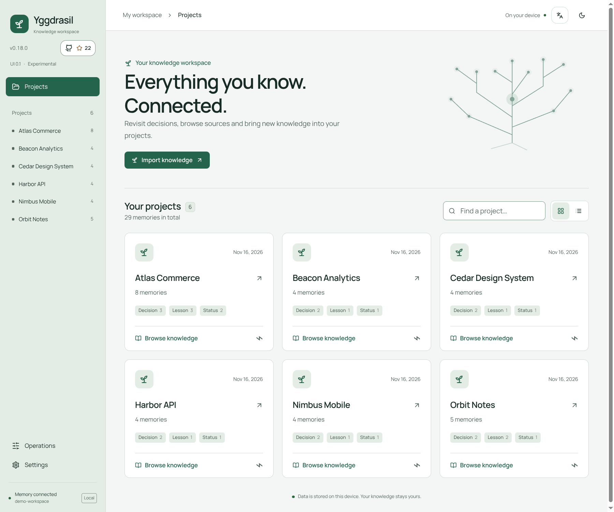
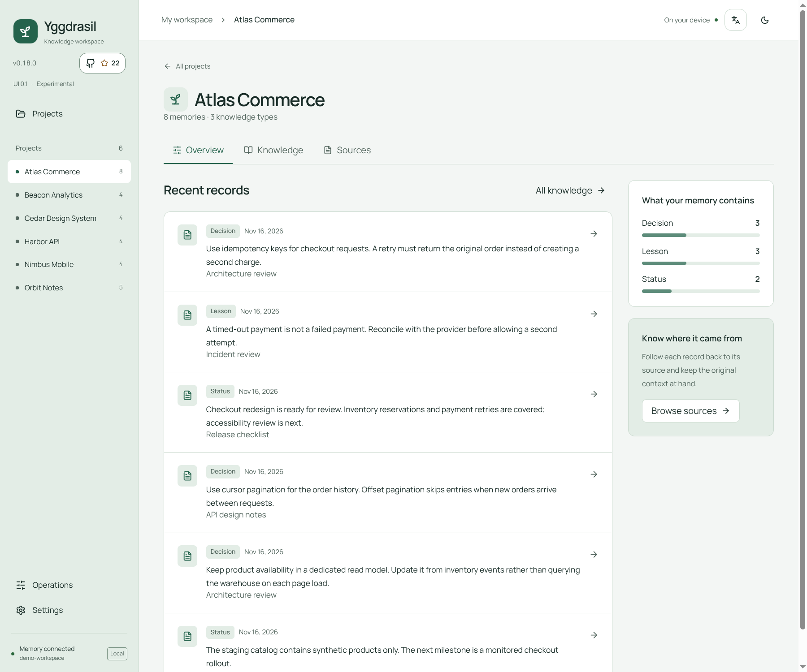
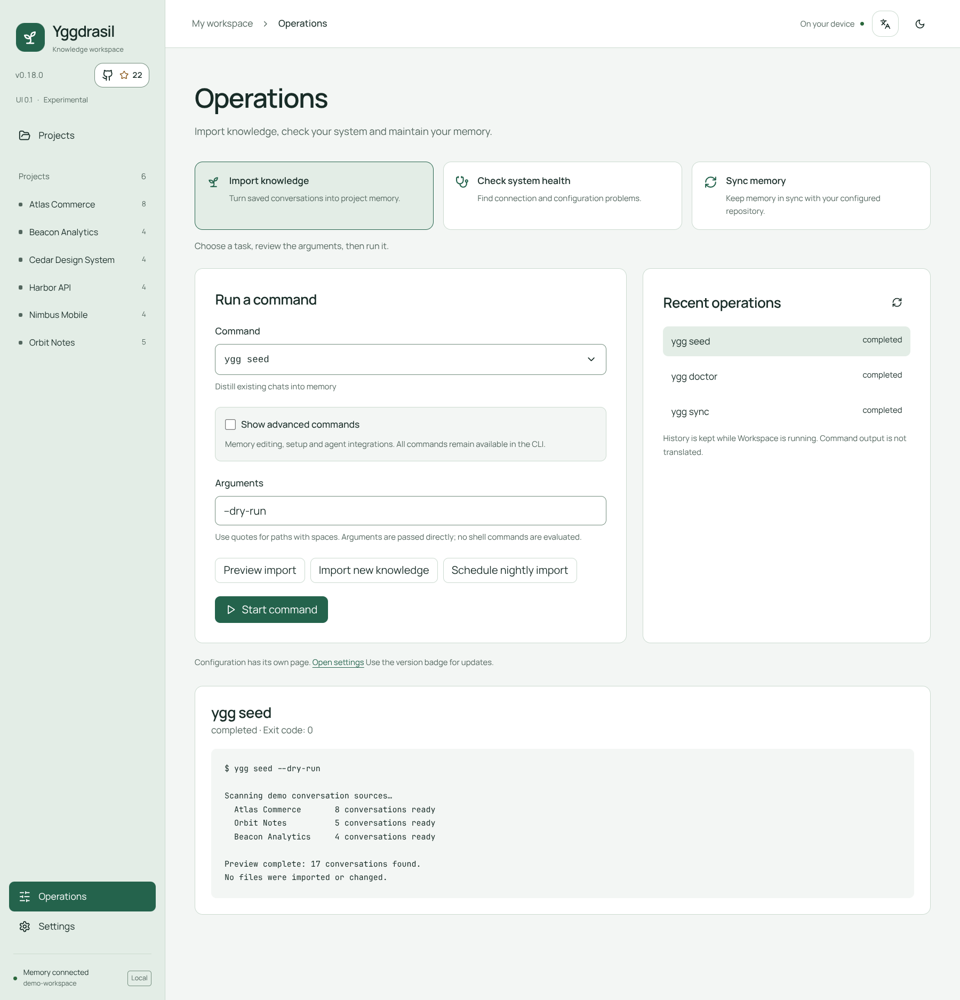

# Yggdrasil Workspace — UI 0.1 Experimental

Run `ygg` to open a local interface for your knowledge. Workspace ships with
**Yggdrasil 0.18.0**, while the interface has its own version, **UI 0.1 Experimental**.
The Python package includes the web app; you do not need Node.js to use it.
All existing CLI commands remain available.

## Your projects at a glance

The home page brings together projects from your memory, with record counts,
knowledge types and the date of the latest record. Find a project by name,
switch between cards and a list, or start importing knowledge.

## Inside a project

Each project has three views:

- **Overview:** recent records and a breakdown of knowledge types.
- **Knowledge:** search and filter records, then open one to read its details.
- **Sources:** see where records came from and browse their original context.

Project data stays scoped to the user and namespace selected in your configuration.
**Graph and Chat are temporarily hidden** in this experimental interface;
stored conversations, relations and backend data are preserved.

## Operations without leaving the browser

Start with **Import knowledge**, **Check system health** or **Sync memory**.
These cards select a command so you can review its arguments before running it.
Seed defaults to `--dry-run` to preview an import.

The selector groups 14 everyday commands and describes what each does.
Enable **Show advanced commands** for less frequent maintenance and memory tasks.
Watch output and status, respond to interactive prompts, or stop a running command.
Actions that change local state require confirmation.

Configuration has its own Settings page; updates open from the version badge.
CLI aliases and service entry points remain available in the terminal.

## Settings, models and appearance

**Configuration** exposes the settings available through `ygg config`, including
background processing, embeddings, user identity and namespace. Model selectors
list models available from the configured local runtime, including Ollama and
LM Studio. Secrets are stored separately and their values are not returned to
the browser.

Choose **English, Russian, German, Spanish, French, Japanese or Chinese** from
the language menu. English is the default. The interface is translated;
your records and original command output remain in their original language.

Appearance offers **neutral, green, blue, orange and pink** palettes, each in
light and dark modes. The theme button switches modes while keeping your palette.
Language and appearance choices are saved in the browser.

## Versions and updates

The sidebar shows the product version, the experimental UI version and a GitHub
link with the repository's star count. When an update is available, click the
version to review and start it. The dialog shows progress and can be closed while
the update continues. A spinner remains by the version; successful completion
and restart produce a notification. If no update is available, the version opens
GitHub Releases.

## Local operation and CLI access

Workspace listens on loopback and opens through a short-lived, one-use sign-in
link. It uses the same local configuration and memory engine as the CLI.
Commands such as `ygg seed`, `ygg config` and `ygg -help` continue to work
independently of the interface.

See the [detailed Workspace guide](workspace.md) for launch options, session
behavior, configuration precedence and operational limits, or the
[CLI guide](ygg-cli.md) for terminal commands.

All screenshots use an isolated demo database with fictional English projects
and operation logs. The demo displays version **0.18.0** and **22 GitHub stars**;
the star count is a screenshot fixture, not a live repository statistic.

[Back to README](../README.md)
